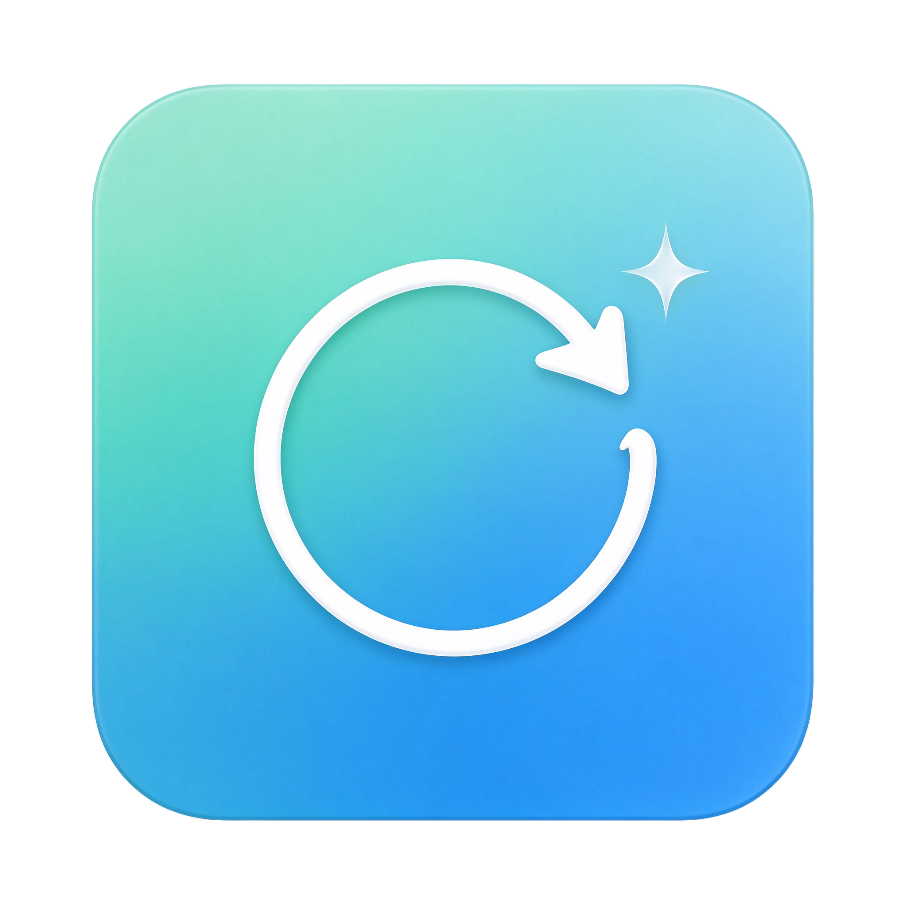

# MacRefresh

**MacRefresh is an independent, open-source app updater for macOS.** It scans the apps on your Mac, finds newer versions from multiple independent sources, and can download and install them for you — no manual web hunting, no account, no tracking. It also includes a free app shop, a download manager, and a set of maintenance and reporting tools.

> MacRefresh is an original, community project. It is **not** affiliated with, endorsed by, or related to any other update utility, and it ships no third-party code or branding. It is released under the MIT license.



---


## Highlights

- **Scans every app**, not just one folder: `/Applications`, your user Applications folder, the Desktop, and any folders you add. Duplicate copies are detected and surfaced.
- **Six independent update sources**, queried with strict version rules so you never get a bogus "update" (no downgrades, no betas on stable channels, no foreign-region App Store results).
- **One-click download + install**: it downloads, verifies, quits the running app, replaces it in place (with a rollback copy), and optionally relaunches it. `.pkg` installers can be installed silently through the native macOS password prompt.
- **Free App Shop**: 190+ genuinely free apps installed straight from each developer's official URL as published in the Homebrew cask catalog. Nothing is paid, cracked, or repackaged.
- **Menu-bar item**, scheduled background checks, quiet hours, a download queue, signatures, reports, and a full tools panel.
- Runs entirely on your machine. No accounts, no telemetry, no phone-home.

## Requirements

- macOS 12.4 Monterey or later (Intel **and** Apple Silicon)
- The Xcode Command Line Tools only if you build from source; the release build needs nothing extra.

## Install

### Prebuilt release (recommended)

1. Open `MacRefresh.dmg`.
2. Drag **MacRefresh** onto the **Applications** folder.
3. Launch it. The first time you update or remove an app macOS may ask for permission; that is the standard App Management / admin prompt.

> The app is ad-hoc signed (not notarized). If Gatekeeper stops it, right-click the app → **Open** → **Open**, or go to **System Settings → Privacy & Security → Open Anyway**. See the GitHub release guide for details.

### Build from source

```bash
# Native build for this Mac
./build.sh

# Universal binary (arm64 + x86_64)
UNIVERSAL=1 ./build.sh
```

Then open `MacRefresh.app`. The build only uses the Swift compiler that ships with Xcode Command Line Tools — there are no third-party dependencies.

---

## Self-update and release channels

MacRefresh updates itself from this repository's GitHub releases.

- A **Release** build (version like `1.0.0`, `1.0.1`) offers only stable releases.
- A **Beta** build (version ends in `b`, `beta`, `rc` or `pre`, e.g. `1.0.1b`) offers newer stable **and** beta/rc builds.
- An **Alpha** build (version ends in `a`, `alpha`, `dev`, `nightly` or `canary`) offers any newer build.
- Stable users can opt into beta builds in **Tools → Security & updates → Include beta/alpha builds**.

Releases are matched by a versioned **Git tag** (`v1.0.0`, `v1.0.1b`, …). Tags without a version number are ignored. The updater downloads the attached `.dmg`, stages it locally, and runs a detached swap script that waits for MacRefresh to quit, backs the current copy up as `.bak_<timestamp>`, installs the new build, clears quarantine and relaunches it. If anything fails it restores the previous copy and reopens the disk image for a manual install.

> Packaging note for maintainers: the self-updater only reads releases that are tagged with a version number (e.g. `v1.0.1b`), and a `.dmg` asset must be attached. Mark beta builds as a GitHub **pre-release**.

## Security

- **Protect my data folders** sets the private support directory and its Downloads/Logs/Mounts/Extracts/Parked folders to owner-only (700/600).
- **Verify MacRefresh integrity** runs `codesign --verify --deep --strict` on the running bundle.
- **Scan app folders for risks** flags world/group-writable app bundles and executables, unsigned apps, and unexpected quarantine flags.
- **Repair risky permissions** removes group/world write access, restores the executable bit and strips quarantine flags.

---

## The seven panes

### 1. Overview
A dashboard with app count, update count, last-check time and quick actions. Start a scan, see network status, and jump straight to pending updates.

### 2. Updates
Every app with a genuine newer version. Search, filter by source, show direct-download-only updates, update one app or all at once. Each row shows the installed and available version, the source, and release notes when available.

### 3. Installed
Everything MacRefresh found. Sort by name/version/date/size, filter by architecture (Universal / Intel / Apple Silicon), signature status, and quarantine, and search. Double-click to open; right-click for update, verify, reveal, copy bundle ID/version, ignore, or uninstall.

### 4. Shop
The free app shop. Browse 190+ curated free apps by category (Browsers, Communication, Media, Productivity, Developer, Utilities, Internet, Graphics, Audio, Security, Games), with icons, versions, and one-click install. Filter to All / Not installed / Installed / Favorites and multi-select.

### 5. Downloads
A real download queue: pause, resume, cancel, retry, reveal, clear, and bulk pause/resume/retry/cancel. Live progress, per-app download speed, and an empty-state when there is nothing queued.

### 6. Tools
Update history with rollback builds, storage management with real sizes, reports in six formats, signature verification, maintenance actions, and a **Security & updates** section for in-app self-update, data-folder protection, integrity verification and app-folder security scans.

### 7. Settings
Behavior, scheduled checks, speed/concurrency, storage and retention, downloads folder, custom update sources, ignored apps, and appearance.

---

## Update sources

| Source | How it works |
|---|---|
| **Homebrew cask index** | The public Homebrew cask catalog; versions are matched against the exact app token. |
| **Sparkle / Squirrel feeds** | The standard app-update XML feeds embedded in apps themselves. |
| **App Store lookup** | The public iTunes lookup API, restricted to your own storefront and the exact bundle ID. |
| **GitHub releases** | Release assets for GitHub-hosted apps (many Electron apps). |
| **`asar` / package.json** | Version metadata for Electron apps. |
| **Custom web URLs** | Any feed URL you add yourself. |

### Strict version rules (no fake updates)

- Leading prefixes (`v`, `V`, `version `), parentheses, brackets and underscores are normalized, so **v1.63 and 1.63 are the same version** and never flag an update.
- Pre-release/beta/rc versions are **not** offered on the stable channel.
- Placeholder versions like `0.0.0.x` are ignored.
- An older catalog version never downgrades a newer installed app (e.g. Chrome's self-updated build).
- App Store results must match the exact bundle ID and your storefront, so an app that is already current in the App Store never appears.

## Installing and replacing apps

- Before replacing an app, MacRefresh asks it (and all of its helper processes) to quit, waits, then force-quits only what remains inside that bundle.
- The previous copy is moved aside for **rollback** and is restored automatically if the new copy fails.
- On macOS Sequoia's App Management protection, it falls back to the native administrator password dialog.
- `.pkg` installers can be installed silently (`/usr/sbin/installer` with the native password prompt) instead of merely opening the installer.
- App Store apps are handed off to the App Store, which performs that update itself.

## Duplicate apps

When several copies of the same app are found (for example one on the Desktop and one in `/Applications`), Installed and Tools let you: reveal the duplicates, keep a specific copy, move the extras to the Trash, or clear all duplicates in one action.

---

## Command-line usage

MacRefresh is a GUI app, but it includes a small headless interface for automation:

```bash
# Run the built-in test suite (writes only to a temp directory)
./MacRefresh.app/Contents/MacOS/MacRefresh --selfcheck

# Print a scan of installed apps and available updates
./MacRefresh.app/Contents/MacOS/MacRefresh --scan

# The same scan as CSV
./MacRefresh.app/Contents/MacOS/MacRefresh --csv

# Inspect a Homebrew cask (read-only; prints version and download URL)
./MacRefresh.app/Contents/MacOS/MacRefresh --resolve-cask google-chrome

# Download and install a cask (performs the full install pipeline)
./MacRefresh.app/Contents/MacOS/MacRefresh --install-cask the-unarchiver

# Silently install a local .pkg via the native password prompt
./MacRefresh.app/Contents/MacOS/MacRefresh --install-pkg /path/to/installer.pkg

# Open a specific pane: overview|updates|installed|shop|downloads|tools|settings
./MacRefresh.app/Contents/MacOS/MacRefresh --pane updates
```

## Features (summary)

- **Updating:** multi-source checks, strict version comparison, bulk update, update all, skip-this-version, release notes, direct-only filter, source filter, retry/backoff, pre-release and placeholder gates, build-equivalence checks.
- **Installing:** automatic download, verify, quit-tree, force-quit of a bundle's helpers, in-place replace with rollback, admin fallback, silent PKG install, App Store handoff, relaunch-after-update.
- **Scanning:** multiple standard folders, extra folders, Desktop and home Applications, duplicate detection, architecture and signature and quarantine metadata, ignore list (browse to ignore), persisted sorting.
- **Shop:** 190+ free apps, categories, search, real and monogram icons, favorites, segments, single/multi/all install, homepage link.
- **Downloads:** queue with pause/resume/cancel/retry/clear and bulk controls, per-app speed, configurable concurrency and attempts, custom downloads folder.
- **Tools:** update history, rollback builds, reveal/clear, storage management with real sizes, reports in CSV/JSON/HTML/Markdown/PDF, copy report, export diagnostics, run diagnostics, verify all signatures, force catalog refresh, rotate logs, reveal log, install essentials bundle, self-update, data-folder lockdown, integrity verification and security scan/repair.
- **Customization:** scheduled checks, quiet hours, launch at login, menu-bar item with quick menu and recent activity, dock badge, click-to-open, dark/light/system appearance, downloads folder, retention/pruning, settings export/import/reset.
- **Safety:** signature verification, quarantine awareness, owner-only data-folder lockdown, app-folder permission scan and repair, self-integrity checks, uninstall with confirmation, duplicate trash with confirmation, no tracking, local-only data.
- **Self-update:** channel-aware GitHub release checks (alpha/beta/release), download-verify-stage-swap with automatic backup and restore, opt-in beta channel, and a visible channel badge.

## Privacy

MacRefresh does not collect or send any personal data. It only contacts the public update sources listed above when you ask for a check, the public GitHub API (`api.github.com/repos/JaydenLeung0818/MacRefresh`) for its own self-updates, and GitHub release downloads when you choose to install an update. It stores its catalog and downloads in `~/Library/Application Support/MacRefresh/`.

## License

[MIT](LICENSE) — Copyright © Jayden Leung. All app and company names mentioned are the property of their respective owners and are used only to identify those apps.
